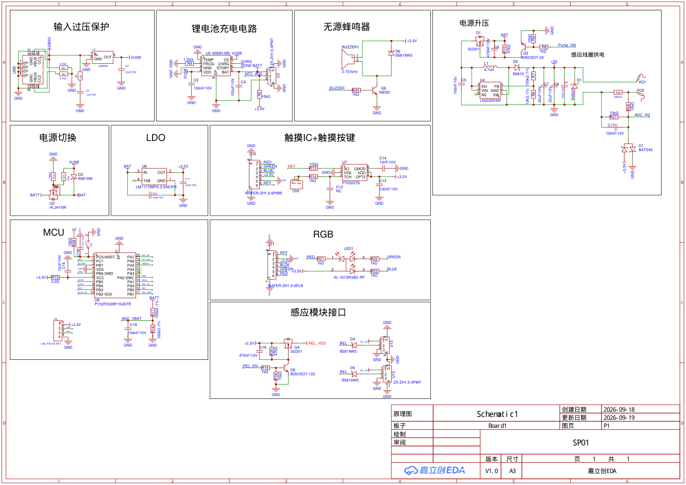

# SP01 硬件设计

本目录公开经项目负责人确认的 SP01 原理图、两份 PCB 导出、整项目导出和 BOM（Bill of Materials，元器件清单），用于非商业学习和改编。项目有权授权的原创硬件设计采用 [CC BY-NC 4.0](../LICENSE-DOCS-HARDWARE)；不授予元器件厂商商标或第三方设计权利。

供应商规格书、客户产品规格书、采购资料、其他饮水机型号以及未逐文件检查的设计/打样压缩包不在本仓库发布范围。

## 文件与版本

| 文件 | 内容 |
| --- | --- |
| `cad/2026-09-23/ProPrj_SP01_2026-09-23.epro2` | 嘉立创 EDA 专业版整项目导出 |
| `cad/2026-09-23/ProDoc_PCB1_2026-09-23.epro2` | PCB1 导出 |
| `cad/2026-09-23/ProDoc_PCB2_2026-09-23.epro2` | PCB2 导出 |
| `cad/2026-09-23/SCH_Schematic1_2026-09-23.pdf` | 可直接查看的原理图 |
| `cad/2026-09-23/BOM_Board1_Schematic1_2026-09-23.xlsx` | Board1 元器件清单 |

`.epro2` 是嘉立创 EDA 专业版的工程导出文件；在兼容版本中导入工程后检查原理图、封装、网络和设计规则。公开整理只验证了归档结构和隐私元数据，没有在 EDA 软件内完成重新导入、连通性或可制造性验收。

文件名中的 2026-09-23 是导出标识，图框另标有较早创建/更新日期。后续 007 调试资料引用过 2026-10-13 采样电路，因此这些图不能直接视为与 007 实物完全一致的量产图纸。

导出副本清空了 EDA 中嵌入的 `user` 元数据对象以及 BOM 的作者/最后修改者字段；元器件数据、坐标、对象引用和 BOM 表格 XML 保持不变。原始与公开文件的 SHA-256、清理字段数量见 [硬件来源清单](../docs/hardware-manifest.json)。原文件保留在私有归档。

## 当前固件连接

| 引脚/信号 | 作用 | 注意事项 |
| --- | --- | --- |
| PB2 / Pump_ON | 无线发射/泵使能 | 代码为高电平开泵；先核对实物驱动极性 |
| PA7 / REL_EN | 雷达供电使能 | 板级适配集中控制 |
| PC1 / REL | 雷达活动输入 | 先去抖，再交状态机 |
| PB0 / KEY | 触摸输入 | 代码按低电平有效 |
| PB4 / CHRG | 充电进行中 | 低电平有效，与 DONE 共同辅助供电识别 |
| PB5 / DONE | 充满状态 | 低电平有效；没有独立 Type-C VBUS 检测输入 |
| PA3 / ADC_IN1 | 007 的负载采样输入 | 不同旧图可能标到别的脚；必须核对实际改板 |
| PB1 / ADC_IN0 | 电池分压采样 | 当前按 100 kΩ / 100 kΩ 换算 |
| PA6 / ADC_IN3 | NTC 温度相关采样 | 采样存在不代表完整温度保护已验收 |
| PB7 | 蜂鸣器驱动 | 定时器输出与具体驱动电路匹配 |
| PB3 / PA5 / PA1 | RGB 三路输出 | 低电平点亮；实物红蓝和部分源码命名不一致，见已知限制 |

MCU（Microcontroller Unit）就是执行固件的单片机；GPIO（General-Purpose Input/Output）是可配置的输入输出脚；ADC 是读取模拟电压的硬件。引脚名称中的数字不等于 ADC 通道号，例如 PA3 在本芯片上使用 ADC_IN1。

上板先确认供电、关泵输出和 SWD，再逐项验证输入与采样。没有实测证据时，不能将设计文件存在、源码编译成功或归档校验通过等同于整机可靠。
